# Process: interest-calculation

| Property | Value |
|----------|-------|
| Type | Main Process (batch) |
| Legacy Source | Job `ACCRUE` (`/app/jcl/ACCRUE.jcl`, `PARM='2022071800'`), program `LXB002C`, copybooks `LXV026Y`, `LXV027Y`, `LXV022Y`, `LXV024Y`, `LXV030Y` |
| Trigger | Called by [end-of-day-batch-chain](process-end-of-day-batch-chain.md) (monthly folder in Control-M) |
| Roles | Batch Operator (system) |
| Integration | [workflow-reference-data-access](../04-integrations/workflow-reference-data-access.md), [workflow-account-data-access](../04-integrations/workflow-account-data-access.md), [workflow-transaction-data-access](../04-integrations/workflow-transaction-data-access.md) |
| Acceptance Criteria | [acceptance-criteria-interest-calculation](../10-acceptance-criteria/acceptance-criteria-interest-calculation.md) |
| Mapping | P-15 |

## Purpose

For each account/type/category balance, finds the disclosure-group interest rate, computes monthly interest, posts a batch transaction (type 07, category 12) and updates the account balance, resetting cycle credit/debit totals.

## Process Flow

```mermaid
flowchart LR
    S(["Start"]) --> SND1["Send Message<br/>List Category Balances by Account"]
    SND1 --> RCV1["Receive Message<br/>Balances"]
    RCV1 --> SP["Subprocess<br/>For Each Account"]
    SP --> SND2["Send Message<br/>Get Disclosure Rate"]
    SND2 --> RCV2["Receive Message<br/>Rate"]
    RCV2 --> G1{"Rate found<br/>for group?"}
    G1 -->|"No"| SND3["Send Message<br/>Get STANDARD Rate"]
    SND3 --> RCV3["Receive Message<br/>Default Rate"]
    G1 -->|"Yes"| C["Service Task<br/>Compute Interest"]
    RCV3 --> C
    C --> G2{"Rate<br/>not 0?"}
    G2 -->|"Yes"| SND4["Send Message<br/>Write Interest Transaction"]
    SND4 --> RCV4["Receive Message<br/>Write Result"]
    G2 -->|"No"| ACC
    RCV4 --> ACC["Service Task<br/>Accumulate Total Interest"]
    ACC --> G3{"Account<br/>done?"}
    G3 -->|"No"| SND2
    G3 -->|"Yes"| SND5["Send Message<br/>Update Account"]
    SND5 --> RCV5["Receive Message<br/>Update Result"]
    RCV5 --> E(["End"])
    style SND1 fill:#F5A623,color:#000
    style RCV1 fill:#F5A623,color:#000
    style SND2 fill:#F5A623,color:#000
    style RCV2 fill:#F5A623,color:#000
    style SND3 fill:#F5A623,color:#000
    style RCV3 fill:#F5A623,color:#000
    style SND4 fill:#F5A623,color:#000
    style RCV4 fill:#F5A623,color:#000
    style SND5 fill:#F5A623,color:#000
    style RCV5 fill:#F5A623,color:#000
```

