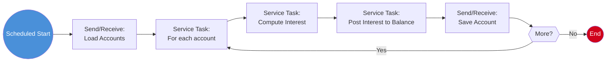

# Process: Interest Calculation (Batch Pipeline)

> **Powered by FLOWX.AI Coding Agents**

| Field | Value |
|-------|-------|
| **Name** | Interest Calculation |
| **Type** | Scheduled Process (orchestration) |
| **Legacy Source** | `LXB002C` (+ `LXB0001–03C`) via `ACCRUE.jcl`; disclosure config `RATEGRP.jcl` |
| **Status** | Draft |
| **Related Data** | [Account](../01-data-model/project-data-model.md#account), [TransactionCategoryBalance](../01-data-model/project-data-model.md#transactioncategorybalance) |

## Business Description

Periodic pipeline that computes interest for each account based on its balance and disclosure/interest group, then posts the interest to the account. Replaces the `LXB002C`/`ACCRUE` batch. The interest-rate parameters come from the disclosure-group reference data (`RATEGRP`).

## Process Flow

## Nodes

| # | Node | Type | Description | Legacy Reference |
|---|------|------|-------------|------------------|
| 1 | Scheduled Start | Start Event (Scheduled Trigger) | Interest cycle | `ACCRUE.jcl` |
| 2 | Load Accounts | Send/Receive Message Task | Read accounts | `LXB001C` read |
| 3 | For each account | Service Task (loop) | Iterate | main loop |
| 4 | Compute Interest | Service Task (NoOpHandler) | `interest = balance × rate(group)` | `LXB002C` |
| 5 | Post Interest | Service Task (NoOpHandler) | Add interest to balance | balance update |
| 6 | Save Account | Send/Receive Message Task | Persist | `REWRITE LEDGFILE` |

## Business Rules

#### Rule: ComputeInterest
- **Legacy source:** `LXB002C` interest computation using disclosure-group rate.
- **Logic:** `interest = currentBalance × interestRate(groupId)`; posted to balance and category balance.
- **FLOWX implementation:** NoOpHandler; interest rate from disclosure-group reference data / Configuration Parameter.
- `{{TODO: Extract exact interest formula, rounding, and grouping from LXB002C + RATEGRP.}}`

## Integration Touchpoints

| Send Node | Topic | Payload | Receive | System |
|-----------|-------|---------|---------|--------|
| Load Accounts | `ai.flowx.in.ledgerline.datastore.loadaccounts` | `{ page }` | Account[] | FlowX Persistence |
| Save Account | `ai.flowx.in.ledgerline.datastore.saveaccount` | Account | ack | FlowX Persistence |

## Swimlanes

- **System**

---
*Powered by **FLOWX.AI** Coding Agents*
