# Process: end-of-day-batch-chain

| Property | Value |
|----------|-------|
| Type | Main Process (orchestrator for batch Call Activities) |
| Legacy Source | Control-M folders (`/app/scheduler/Ledgerline.controlm`), CA-7 definition (`/app/scheduler/Ledgerline.ca7`, schedule 000652), jobs `CLOSEDS`, `TXNBKUP`, `WAITSTEP`, `OPENDS`, `POSTDAY`, `ACCRUE`, `MERGETXN`, `MAKESTMT`, `TXNREPT`, `RATEGRP`; assembler `MVSWAIT` / COBOL `LXO012T` |
| Trigger | Scheduled Trigger (daily / weekly / monthly) — see [Trigger Inventory](../05-triggers/trigger-inventory.md) |
| Roles | Batch Operator (system) |
| Acceptance Criteria | [acceptance-criteria-end-of-day-batch-chain](../10-acceptance-criteria/acceptance-criteria-end-of-day-batch-chain.md) |
| Mapping | P-19 |

## Purpose

Coordinates the nightly/monthly batch cycle that in the mainframe is: close CICS files (`CLOSEDS`) → post transactions → interest → combine → statements → reports → reopen CICS files (`OPENDS`).

{{DECISION: In FlowX there are no CICS files to close/open. `CLOSEDS`, `OPENDS` and `WAITSTEP` (pure wait) are **dropped** from the technical flow and replaced by a processing-window flag (`batchWindowOpen`) that blocks online data-changing processes during the run.}}

{{TODO: confirm with business whether online access must be blocked during the batch run}}

## Process Flow

```mermaid
flowchart LR
    S(["Start<br/>Scheduled"]) --> W1["Service Task<br/>Open Batch Window"]
    W1 --> B["Call Activity<br/>Transaction Backup"]
    B --> P["Call Activity<br/>daily-transaction-posting"]
    P --> G1{"Monthly<br/>run?"}
    G1 -->|"Yes"| I["Call Activity<br/>interest-calculation"]
    I --> C["Call Activity<br/>combine-transactions"]
    C --> ST["Call Activity<br/>statement-generation"]
    G1 -->|"No"| R
    ST --> R["Call Activity<br/>transaction-report"]
    R --> W2["Service Task<br/>Close Batch Window"]
    W2 --> E(["End"])
    style P fill:#7BC67E,color:#000
    style I fill:#7BC67E,color:#000
    style C fill:#7BC67E,color:#000
    style ST fill:#7BC67E,color:#000
    style R fill:#7BC67E,color:#000
    style B fill:#7BC67E,color:#000
```

## Legacy Job Mapping

| Legacy Job | Program | Control-M Folder | FlowX Node |
|------------|---------|------------------|------------|
| CLOSEDS | IEFBR14/CICS close | DAILY, WEEKLY(RATEGRP), MONTHLY | Open Batch Window |
| TXNBKUP | IDCAMS REPRO | DAILY-TransactionBackup | Transaction Backup (Call Activity: export `transactions` snapshot) |
| WAITSTEP | `LXO012T` / `MVSWAIT` | DAILY, WEEKLY, MONTHLY | dropped |
| OPENDS | CICS open | DAILY, WEEKLY, MONTHLY | Close Batch Window |
| POSTDAY | `LXB007C` | (chain) | [daily-transaction-posting](process-daily-transaction-posting.md) |
| ACCRUE | `LXB002C` | MONTHLY-InterestCalculation | [interest-calculation](process-interest-calculation.md) |
| MERGETXN | SORT/REPRO | MONTHLY-InterestCalculation | [combine-transactions](process-combine-transactions.md) |
| MAKESTMT | `LXB005A/B` | (chain) | [statement-generation](process-statement-generation.md) |
| TXNREPT | `LXB008C` | (chain) | [transaction-report](process-transaction-report.md) |
| RATEGRP | IDCAMS REPRO | WEEKLY-DisclosureGroupsRefresh | [master-data-load](process-master-data-load.md) (reference refresh) |
| LXZ0332 | `LXO013T` | WEEKLY-TransactionTypesDBRefresh | [transaction-type-batch-maintenance](process-transaction-type-batch-maintenance.md) |
| LXB004J | `LXB003C` | triggered from CLOSEDS (CA-7 SCHID 030) | [expired-authorization-purge](process-expired-authorization-purge.md) |

## Scheduler Facts

- Control-M folders (APPLICATION `LEDGER-LINE`, RUN_AS `xuemingh`, TIMETO 23:00): DAILY-TransactionBackup, WEEKLY-TransactionTypesDBRefresh, WEEKLY-DisclosureGroupsRefresh, MONTHLY-InterestCalculation.
- `TXNEXTR` is listed under the WEEKLY-DisclosureGroupsRefresh parent folder (misplacement, finding F-16).
- CA-7: system `LEDGERLINE`, JCLLIB `&LEDGERLINEPRODJCL`, schedule 000652; `CLOSEDS` triggers `LXB004J` (SCHID=030).
- Cron expressions are not defined in the extracted definitions: {{TODO: obtain run days/times (the Control-M XML shows all months enabled and TIMETO=23:00 only)}}.

## Business Rules

| # | Rule | Legacy Source |
|---|------|---------------|
| BR-01 | Order: posting before interest, interest before combine, combine before statements, statements before reports | Control-M / README job chain |
| BR-02 | A failing step stops the chain (`COND=(0,NE)` on later steps) | `MAKESTMT.JCL`, others |
| BR-03 | Posting with rejects (`RETURN-CODE 4`) does not stop the chain | `LXB007C` |
| BR-04 | Run window ends by 23:00 (`TIMETO`) | Control-M |

## Data Mapping

Process start data: `batchId`, `businessDate`, `runType` (DAILY / WEEKLY / MONTHLY). Call Activity INPUT: `batchId`, `businessDate`, `interestRunDate`. OUTPUT: `status`, `processedCount`, `rejectedCount`.

## Configuration Dependencies

`schedulerEndTime`, `interestRunDate`, `reportStartDate`, `reportEndDate`, `batchWindowOpen` (runtime flag → FeatureToggle Data Type `OptionalModuleToggles` extension {{DECISION: add `batchWindowOpen` to a separate `RuntimeSwitches` FeatureToggle}}).
