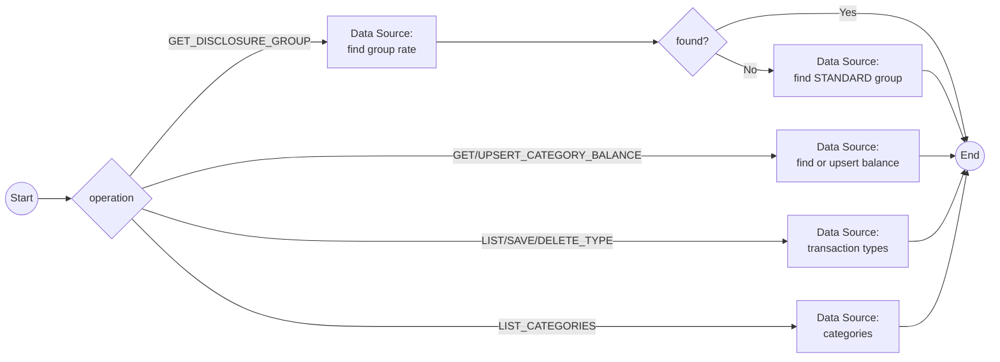

# Workflow: reference-data-access

## Metadata

| Field | Value |
|-------|-------|
| System | [ledgerline-datastore](system-ledgerline-datastore.md) (NOSQL_DB) |
| Trigger Source | Process (MESSAGE_EVENT_SEND with StartIntegrationWorkflowHandler) |
| Trigger Processes | [P-14](../02-processes/process-daily-transaction-posting.md), [P-15](../02-processes/process-interest-calculation.md), [P-18](../02-processes/process-transaction-report.md), [P-21](../02-processes/process-master-data-load.md), [P-25](../02-processes/process-transaction-type-maintenance.md), [P-26](../02-processes/process-transaction-type-batch-maintenance.md) |
| Legacy Source | `BALCATF`, `RATEGRP`, `TXNTYPE`, `TXNCATG` (VSAM) and DB2 `TRANSACTION_TYPE`, `TRANSACTION_TYPE_CATEGORY`; programs `LXB007C`, `LXB002C`, `LXB008C`, `COTRTLIC`, `COTRTUPC`, `LXO013T` |
| Mapping | W-05 |

## Workflow Flow

## Nodes and Operations

| Operation | Data Source operation | Input | Output |
|-----------|----------------------|-------|--------|
| GET_DISCLOSURE_GROUP | find `disclosureGroups` by group, type, category; if missing, find with group `STANDARD` | `groupId`, `typeCode`, `categoryCode` | `interestRate`, `usedDefault` |
| GET_CATEGORY_BALANCE / UPSERT_CATEGORY_BALANCE | find / upsert `categoryBalances` | `accountId`, `typeCode`, `categoryCode`, `delta` | `balance` |
| LIST_CATEGORY_BALANCES | query by `accountId` | `accountId` | `balances[]` |
| LIST_TYPES | query `transactionTypes` with filters, paged | `typeFilter`, `descriptionFilter`, `cursor` | `types[]` |
| SAVE_TYPE / DELETE_TYPE | upsert / delete; delete blocked if categories exist | `type` | `status` |
| LIST_CATEGORIES | query `transactionCategories` by `typeCode` | `typeCode` | `categories[]` |
| GET_TYPE_DESCRIPTION | lookup description (report) | `typeCode`, `categoryCode` | `typeDescription`, `categoryDescription` |

## Data Mappings

RECEIVE (`referenceResult`): `interestRate`, `usedDefault`, `balance`, `balances[]`, `types[]`, `categories[]`, `status`, `message`. Interest rate is stored as a decimal percentage (legacy encoded value such as `0150{` = 15.00 is converted at load time, see [enumerations](../01-data-model/enumerations.md)).

## Error Handling

Missing disclosure group → STANDARD fallback (BR in P-15); delete with children → status `RESTRICTED`; timeout → retry 3 times.
