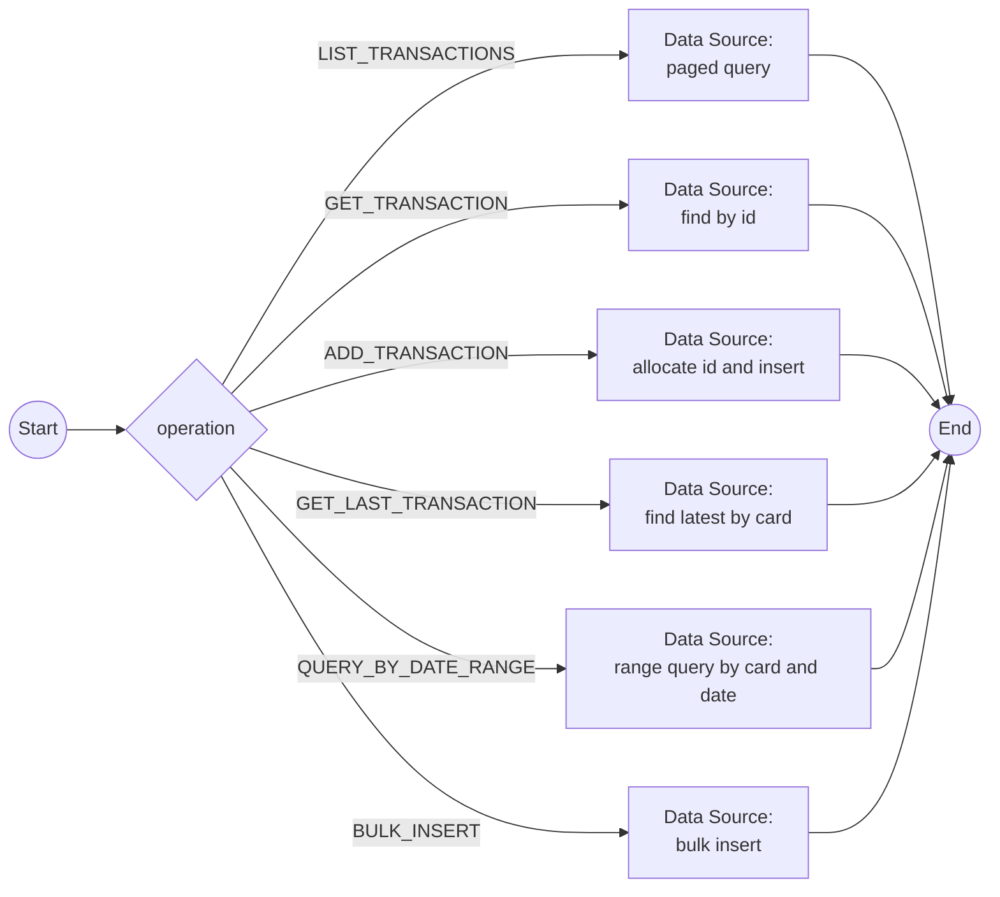

# Workflow: transaction-data-access

## Metadata

| Field | Value |
|-------|-------|
| System | [ledgerline-datastore](system-ledgerline-datastore.md) (NOSQL_DB) |
| Trigger Source | Process (MESSAGE_EVENT_SEND with StartIntegrationWorkflowHandler) |
| Trigger Processes | [P-08](../02-processes/process-transaction-list.md), [P-09](../02-processes/process-transaction-view.md), [P-10](../02-processes/process-transaction-add.md), [P-11](../02-processes/process-bill-payment.md), [P-14](../02-processes/process-daily-transaction-posting.md), [P-15](../02-processes/process-interest-calculation.md), [P-16](../02-processes/process-combine-transactions.md), [P-17](../02-processes/process-statement-generation.md), [P-18](../02-processes/process-transaction-report.md) |
| Legacy Source | `LXO018C`–`LXO019C`, `LXO011C` (`TXNFILE` browse/read/write), `LXB007C`, `LXB002C`, `LXB008C`, `LXB005A`, `MERGETXN.jcl` |
| Mapping | W-04 |

## Workflow Flow

## Nodes and Operations

| Operation | Data Source operation | Input | Output |
|-----------|----------------------|-------|--------|
| LIST_TRANSACTIONS | query `transactions` ordered by id, start at `startTransactionId`, page of 10 | `startTransactionId`, `direction`, `pageSize` | `transactions[]`, `hasNext`, `hasPrevious` |
| GET_TRANSACTION | find by `transactionId` | `transactionId` | `transaction`, `found` |
| ADD_TRANSACTION | insert; the new id is allocated by a sequence (replaces "last record + 1") | `transaction` | `transactionId` |
| GET_LAST_TRANSACTION | latest transaction of a card (PF5 copy-last) | `cardNumber` | `transaction` |
| QUERY_BY_DATE_RANGE | transactions between `startDate` and `endDate` (report, statement) | `cardNumber`/`accountId`, dates, `cursor` | `transactions[]`, `nextCursor` |
| BULK_INSERT | insert many (posting, interest, load) | `transactions[]` | counts |

## Data Mappings

RECEIVE (`transactionResult`): `transactions[]` / `transaction.*`, `found`, `transactionId`, counts, `nextCursor`. The id sequence replaces the `STARTBR/READPREV/ENDBR` last-record logic (F-10 duplicate id collision).

## Error Handling

Not found → `found = false`; duplicate id → retry with a new sequence value; timeout → retry 3 times then error status; bulk insert failures are returned per record.
