# Process: interest-calculation

| Property | Value |
|----------|-------|
| Type | Main Process (batch) |
| Legacy Source | Job `INTCALC` (`/app/jcl/INTCALC.jcl`, `PARM='2022071800'`), program `CBACT04C`, copybooks `CVTRA01Y`, `CVTRA02Y`, `CVACT01Y`, `CVACT03Y`, `CVTRA05Y` |
| Trigger | Called by [end-of-day-batch-chain](process-end-of-day-batch-chain.md) (monthly folder in Control-M) |
| Roles | Batch Operator (system) |
| Integration | [workflow-reference-data-access](../04-integrations/workflow-reference-data-access.md), [workflow-account-data-access](../04-integrations/workflow-account-data-access.md), [workflow-transaction-data-access](../04-integrations/workflow-transaction-data-access.md) |
| Acceptance Criteria | [acceptance-criteria-interest-calculation](../10-acceptance-criteria/acceptance-criteria-interest-calculation.md) |
| Mapping | P-15 |

## Purpose

For each account/type/category balance, finds the disclosure-group interest rate, computes monthly interest, posts a system transaction (type 01, category 05) and updates the account balance, resetting cycle credit/debit totals.

## Process Flow

```mermaid
flowchart LR
    S(["Start"]) --> SND1["Send Message<br/>List Category Balances by Account"]
    SND1 --> RCV1["Receive Message<br/>Balances"]
    RCV1 --> SP["Subprocess<br/>For Each Account"]
    SP --> SND2["Send Message<br/>Get Disclosure Rate"]
    SND2 --> RCV2["Receive Message<br/>Rate"]
    RCV2 --> G1{"Rate found<br/>for group?"}
    G1 -->|"No"| SND3["Send Message<br/>Get DEFAULT Rate"]
    SND3 --> RCV3["Receive Message<br/>Default Rate"]
    G1 -->|"Yes"| C["Service Task<br/>Compute Interest"]
    RCV3 --> C
    C --> G2{"Rate<br/>not 0?"}
    G2 -->|"Yes"| SND4["Send Message<br/>Write Interest Transaction"]
    SND4 --> RCV4["Receive Message<br/>Write Result"]
    G2 -->|"No"| ACC
    RCV4 --> ACC["Service Task<br/>Accumulate Total Interest"]
    ACC --> G3{"Account<br/>done?"}
    G3 -->|"No"| SND2
    G3 -->|"Yes"| SND5["Send Message<br/>Update Account"]
    SND5 --> RCV5["Receive Message<br/>Update Result"]
    RCV5 --> E(["End"])
    style SND1 fill:#F5A623,color:#000
    style RCV1 fill:#F5A623,color:#000
    style SND2 fill:#F5A623,color:#000
    style RCV2 fill:#F5A623,color:#000
    style SND3 fill:#F5A623,color:#000
    style RCV3 fill:#F5A623,color:#000
    style SND4 fill:#F5A623,color:#000
    style RCV4 fill:#F5A623,color:#000
    style SND5 fill:#F5A623,color:#000
    style RCV5 fill:#F5A623,color:#000
```

## Business Rules

| # | Rule | Legacy Source |
|---|------|---------------|
| BR-01 | Rate lookup key: `account.groupId + typeCode + categoryCode` | `CBACT04C` |
| BR-02 | If not found (file status 23), retry with group `DEFAULT` | `CBACT04C` |
| BR-03 | If rate ≠ 0: `monthlyInterest = (categoryBalance × rate) / 1200` | `CBACT04C` 1300-COMPUTE-INTEREST |
| BR-04 | Interest transaction: type `01`, category `05`, source `System`, description `Int. for a/c <accountId>`, amount = interest | `CBACT04C` |
| BR-05 | Transaction id = run date prefix (`PARM`, e.g. 2022071800) + running suffix. FlowX: `interestRunDate` Configuration Parameter + sequence | `CBACT04C` |
| BR-06 | At each change of account: `account.currentBalance += totalInterest`; `currentCycleCredit = 0`; `currentCycleDebit = 0`; rewrite account | `CBACT04C` |
| BR-07 | Fees (`1400-COMPUTE-FEES`) is an empty stub — no fees charged (finding F-12; improvement FI-15) | `CBACT04C` |
| BR-08 | `monthlyInterest` is rounded to the nearest cent, halves away from zero (COBOL `COMPUTE ... ROUNDED`): 1000.40 × 18.00 / 1200 = 15.006 → 15.01; −15.006 → −15.01 | `CBACT04C` |
| BR-09 | Legacy opens the transaction output as OUTPUT (overwrites; finding F-07) — FlowX appends | `CBACT04C` |
| BR-10 | Payment (type 02) and Credit (type 03) categories have rate 0 in `discgrp.txt`, hence no interest | `discgrp.txt` |

## Data Mapping

Process start data: `interestRunDate` (Configuration Parameter default; override at start), `batchId`.

SEND `LIST_BALANCES_BY_ACCOUNT` → RECEIVE `balances[]` grouped per account. SEND `GET_DISCLOSURE_RATE` {groupId, typeCode, categoryCode} → RECEIVE {rate, usedFallback}. SEND `WRITE_INTEREST_TRANSACTION` → RECEIVE {transactionId}. SEND `UPDATE_ACCOUNT_AFTER_INTEREST` {accountId, totalInterest} → RECEIVE {status}.

## Configuration Dependencies

| Item | Bucket |
|------|--------|
| interestRunDate | Configuration Parameter |
| divisor 1200 | constant in script (12 months × 100) |
| DisclosureGroupId, TransactionTypeCode, TransactionCategoryCode | Enumeration / seed data |
