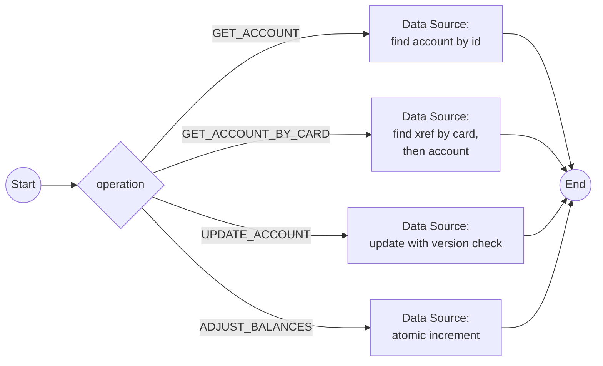

# Workflow: account-data-access

## Metadata

| Field | Value |
|-------|-------|
| System | [carddemo-datastore](system-carddemo-datastore.md) (NOSQL_DB) |
| Trigger Source | Process (MESSAGE_EVENT_SEND with StartIntegrationWorkflowHandler) |
| Trigger Processes | [P-03](../02-processes/process-account-view.md), [P-04](../02-processes/process-account-update.md), [P-10](../02-processes/process-transaction-add.md), [P-11](../02-processes/process-bill-payment.md), [P-14](../02-processes/process-daily-transaction-posting.md), [P-15](../02-processes/process-interest-calculation.md), [P-17](../02-processes/process-statement-generation.md), [P-22](../02-processes/process-authorization-decisioning.md), [P-28](../02-processes/process-mq-inquiry-services.md) |
| Correlation | `processInstanceId` |
| Legacy Source | `READ/REWRITE ACCTDAT`, `CARDXREF` alternate-index reads in `COACTVWC`, `COACTUPC`, `COBIL00C`, `COTRN02C`, `CBTRN02C`, `CBACT04C`, `COACCT01` |
| Mapping | W-01 |

{{DECISION: One workflow per Project Data Type with an `operation` input and a Condition node that routes to the matching DATA_SOURCE node, to keep the number of workflows manageable; split into one workflow per operation if independent versioning is preferred.}}

## Workflow Flow

## Nodes and Operations

| Operation | Node | Data Source operation | Input | Output |
|-----------|------|----------------------|-------|--------|
| GET_ACCOUNT | find account | find one in `accounts` by `accountId` | `accountId` | `account`, `found` |
| GET_ACCOUNT_BY_CARD | find xref, find account | find one in `cardXrefs` by `cardNumber`, then `accounts` | `cardNumber` | `account`, `accountId`, `customerId`, `found` |
| UPDATE_ACCOUNT | update account | update `accounts` where `accountId` and `version` = `expectedVersion` | `account`, `expectedVersion` | `updated`, `conflict` |
| ADJUST_BALANCES | adjust | increment `currentBalance`, `cycleCredit`, `cycleDebit` | `accountId`, deltas | `account`, `status` |

## Data Mappings

SEND payload (process → workflow): `operation`, `accountId` / `cardNumber`, `account` (for update), `expectedVersion`, deltas. RECEIVE payload (workflow → process, written to `accountResult`): `found`, `conflict`, `account.*`, `status`, `message`.

| Direction | Source | Target |
|-----------|--------|--------|
| Process → Send | `${selectedAccountId}` | `jsonDTOMessage.accountId` |
| Workflow → API | `workflow.accountId` | filter `accountId` |
| API → Workflow | `result.document` | `workflow.account` |
| End → Receive | `END.payload.account` | `accountResult.account` |

## Error Handling

| Error | Handling | Outcome |
|-------|----------|---------|
| Not found (legacy `RESP NOTFND`) | `found = false` | Process shows the "not found" message |
| Version conflict | `conflict = true` | Process shows "Record changed by some one else. Please review" |
| Store timeout | retry 3 times with backoff | then error status to process, no data change |
