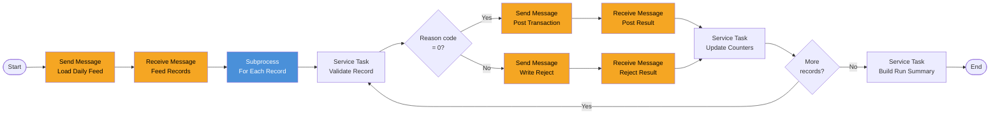

# Process: daily-transaction-posting

| Property | Value |
|----------|-------|
| Type | Main Process (batch) |
| Legacy Source | Job `POSTTRAN` (`/app/jcl/POSTTRAN.jcl`), program `CBTRN02C`, copybooks `CVTRA06Y`, `CVTRA05Y`, `CVACT01Y`, `CVACT03Y`, `CVTRA01Y` |
| Trigger | Called by [end-of-day-batch-chain](process-end-of-day-batch-chain.md); also Manual (operator) |
| Roles | Batch Operator (system) |
| Integration | [workflow-batch-file-transfer](../04-integrations/workflow-batch-file-transfer.md), [workflow-account-data-access](../04-integrations/workflow-account-data-access.md), [workflow-transaction-data-access](../04-integrations/workflow-transaction-data-access.md), [workflow-reference-data-access](../04-integrations/workflow-reference-data-access.md) |
| Acceptance Criteria | [acceptance-criteria-daily-transaction-posting](../10-acceptance-criteria/acceptance-criteria-daily-transaction-posting.md) |
| Mapping | P-14 |

## Purpose

Validates each record of the daily transaction feed (`DALYTRAN`) and posts valid ones: writes the `Transaction`, updates `TransactionCategoryBalance`, and updates the `Account` balance/cycle totals. Invalid records go to the reject store with a reason code. Replaces the legacy sequential read loop.

## Process Flow

## Nodes

| Node | Type | Handler | Description | Legacy Source |
|------|------|---------|-------------|---------------|
| Load Daily Feed | Send Message Task | StartIntegrationWorkflowHandler | `READ_DAILY_FEED` batch (file/message input) | `DALYTRAN-FILE` |
| For Each Record | Subprocess (loop over `feed.records`) | StartSubProcessHandler | One iteration per record | main loop |
| Validate Record | Service Task | NoOpHandler | Lookups come from the Send/Receive pair `VALIDATE_REFERENCES` inside the loop | 1500-VALIDATE-TRAN |
| Post Transaction | Send Message Task | StartIntegrationWorkflowHandler | `POST_TRANSACTION` (Transaction INSERT, TCATBAL upsert, Account UPDATE) | 2000-POST-TRANSACTION |
| Write Reject | Send Message Task | StartIntegrationWorkflowHandler | `WRITE_REJECT` | 2500-WRITE-REJECT-REC |
| Build Run Summary | Service Task | NoOpHandler | processed / rejected counts, return state | end-of-job DISPLAY |

## Business Rules

| # | Rule | Legacy Source |
|---|------|---------------|
| BR-01 | Card number not in CardXref → reject **100** "INVALID CARD NUMBER FOUND" | `CBTRN02C` |
| BR-02 | Account not found → reject **101** "ACCOUNT RECORD NOT FOUND" | `CBTRN02C` |
| BR-03 | Over limit, with a 10% tolerance above the credit limit: `currentCycleCredit − currentCycleDebit + amount > creditLimit × 1.10` → reject **102** "OVERLIMIT TRANSACTION" | `CBTRN02C` |
| BR-04 | `account.expiryDate < transaction original date` → reject **103** "TRANSACTION RECEIVED AFTER ACCT EXPIRATION" (overwrites 102 when both apply — finding F-05; {{DECISION: preserve legacy overwrite order for parity testing, record both reasons as FI-06 improvement}}) | `CBTRN02C` |
| BR-05 | Post: `processedTimestamp = now`; TCATBAL upsert (create on not found); `account.currentBalance += amount`; amount ≥ 0 → `currentCycleCredit += amount`, else `currentCycleDebit += amount` | `CBTRN02C` |
| BR-06 | Rejects carry the original 350-byte image + 4-digit reason + 76-character description | `CBTRN02C` |
| BR-07 | Run ends with state WARNING (legacy `RETURN-CODE = 4`) when any reject exists | `CBTRN02C` |
| BR-08 | Reason 109 (account rewrite failure) aborts the record and is not written to rejects (finding F-05) | `CBTRN02C` |
| BR-09 | Legacy has no commit/restart. FlowX: each record is idempotent via `transactionId`; restart resumes after the last processed index (FI-11; legacy finding F-08) | — |

## Data Mapping

Process start data: `batchId`, `businessDate`, `feedReference` (from [end-of-day-batch-chain](process-end-of-day-batch-chain.md)).

SEND `POST_TRANSACTION`: `dailyTransaction`, `cardNumber`, `accountId` (from xref), `typeCode`, `categoryCode`, `amount`. RECEIVE: `status`, `newBalance`, `transactionId`.

SEND `WRITE_REJECT`: `dailyTransaction`, `rejectReason`, `rejectReasonDescription`. RECEIVE: `status`.

## Configuration Dependencies

| Item | Bucket |
|------|--------|
| batch loop chunk size | Configuration Parameter (`postingChunkSize`) |
| RejectReasonCode | Enumeration |
