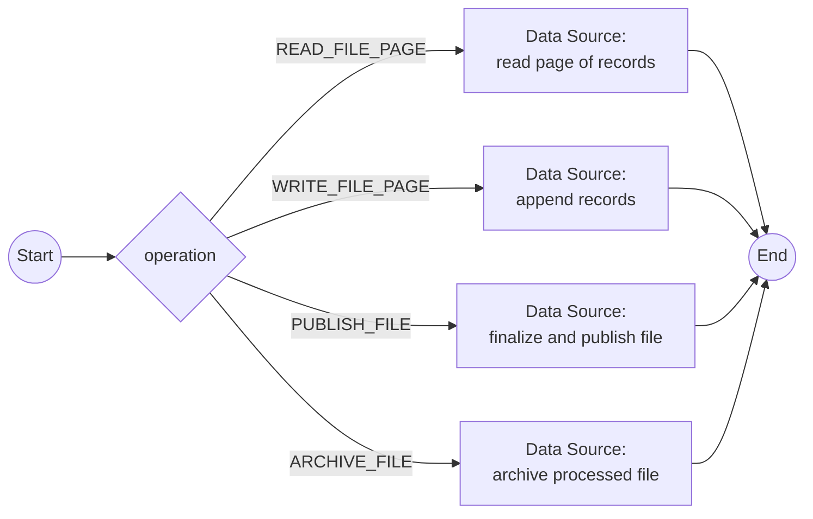

# Workflow: batch-file-transfer

## Metadata

| Field | Value |
|-------|-------|
| System | [batch-file-gateway](system-batch-file-gateway.md) (Kafka custom connector) |
| Trigger Source | Process (MESSAGE_EVENT_SEND with StartIntegrationWorkflowHandler) |
| Trigger Processes | [P-14](../02-processes/process-daily-transaction-posting.md), [P-15](../02-processes/process-interest-calculation.md), [P-16](../02-processes/process-combine-transactions.md), [P-17](../02-processes/process-statement-generation.md), [P-18](../02-processes/process-transaction-report.md), [P-20](../02-processes/process-customer-data-export-import.md), [P-21](../02-processes/process-master-data-load.md), [P-26](../02-processes/process-transaction-type-batch-maintenance.md) |
| Legacy Source | JCL `DD` statements and `REPRO`/`IDCAMS` steps in `/app/jcl/` |
| Mapping | W-09 |

{{DECISION: Files are read in pages (cursor) and returned as structured records instead of streaming the complete dataset through one message, because Kafka messages are size-limited.}}

## Workflow Flow

## Operations

| Operation | Input | Output |
|-----------|-------|--------|
| READ_FILE_PAGE | `fileName`, `cursor`, `pageSize` | `records[]`, `nextCursor`, `recordCount` |
| WRITE_FILE_PAGE | `fileName`, `records[]`, `sequence` | `written` |
| PUBLISH_FILE | `fileName`, `format` (text, HTML, fixed-width) | `fileReference`, `size` |
| ARCHIVE_FILE | `fileName` | `archivedReference` |

## Data Mappings

RECEIVE (`fileResult`): `records[]`, `nextCursor`, `fileReference`, `status`. Dataset names (legacy `AWS.M2.CARDDEMO.*`) become logical file names; `datasetHighLevelQualifier` is a Configuration Parameter.

## Error Handling

File not found / empty → status `NO_DATA`; read error → retry 3 times, then error status. Legacy file status codes (`00`, `10`, `35`, `39`) are mapped to `OK`, `END`, `NOT_FOUND`, `FORMAT_ERROR` {{TODO: confirm file status handling per program}}.
