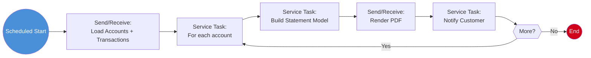

# Process: Statement Generation (Batch Pipeline)

> **Powered by FLOWX.AI Coding Agents**

| Field | Value |
|-------|-------|
| **Name** | Statement Generation |
| **Type** | Scheduled Process (orchestration) |
| **Legacy Source** | `CBSTM03A`/`CBSTM03B` via `CREASTMT.JCL`, `TXT2PDF1.JCL` |
| **Status** | Draft |
| **Related Data** | [Account](../01-data-model/project-data-model.md#account), [Transaction](../01-data-model/project-data-model.md#transaction), [Customer](../01-data-model/project-data-model.md#customer) |
| **Related Plugins** | [Document Strategy](../07-plugins/document-strategy.md) |

## Business Description

Periodic pipeline that produces account statements and renders them to PDF. Replaces `CBSTM03A/B` (`CREASTMT`) with a PDF render step (`TXT2PDF`). Optionally notifies the customer that a statement is available.

## Process Flow

## Nodes

| # | Node | Type | Description | Legacy Reference |
|---|------|------|-------------|------------------|
| 1 | Scheduled Start | Start Event (Scheduled Trigger) | Statement cycle | `CREASTMT.JCL` |
| 2 | Load Accounts + Transactions | Send/Receive Message Task | Gather statement data | `CBSTM03A` read |
| 3 | For each account | Service Task (loop) | Iterate | main loop |
| 4 | Build Statement Model | Service Task (NoOpHandler) | Assemble statement | `CBSTM03B` format |
| 5 | Render PDF | Send/Receive Message Task | Produce PDF | `TXT2PDF1.JCL` |
| 6 | Notify Customer | Service Task (SendNotificationHandler) | "Statement ready" email | `{{TODO: legacy had no email; new capability}}` |

## Integration Touchpoints

| Send Node | Topic | Payload | Receive | System |
|-----------|-------|---------|---------|--------|
| Load Accounts + Transactions | `ai.flowx.in.carddemo.datastore.loadstatementdata` | `{ cycle }` | statement data | FlowX Persistence |
| Render PDF | `ai.flowx.in.carddemo.pdf.render` | `{ statementModel }` | PDF ref | [Statement PDF Renderer](../04-integrations/system-statementpdf.md) |

## Swimlanes

- **System**

See [Document Strategy](../07-plugins/document-strategy.md) for the statement Document Template.

---
*Powered by **FLOWX.AI** Coding Agents*
