# Process: statement-generation

| Property | Value |
|----------|-------|
| Type | Main Process (batch) |
| Legacy Source | Job `CREASTMT` (`/app/jcl/CREASTMT.JCL`), programs `CBSTM03A` (driver) and `CBSTM03B` (file I/O subroutine), copybooks `COSTM01`, `CVACT01Y`, `CVACT03Y`, `CVCUS01Y`, `CVTRA05Y` |
| Trigger | Called by [end-of-day-batch-chain](process-end-of-day-batch-chain.md) |
| Roles | Batch Operator (system); statement recipients are customers |
| Integration | [workflow-account-data-access](../04-integrations/workflow-account-data-access.md), [workflow-transaction-data-access](../04-integrations/workflow-transaction-data-access.md), [workflow-batch-file-transfer](../04-integrations/workflow-batch-file-transfer.md) |
| Plugin | [plugin-statement-document](../07-plugins/plugin-statement-document.md) |
| Acceptance Criteria | [acceptance-criteria-statement-generation](../10-acceptance-criteria/acceptance-criteria-statement-generation.md) |
| Mapping | P-17 |

## Purpose

Produces one statement per card/account with customer name, address, balances, FICO score band and the list of the account's transactions, in text (80 columns) and HTML (100 columns).

## Process Flow

```mermaid
flowchart LR
    S(["Start"]) --> SND1["Send Message<br/>List Cross References"]
    SND1 --> RCV1["Receive Message<br/>Xrefs"]
    RCV1 --> SP["Subprocess<br/>For Each Card"]
    SP --> SND2["Send Message<br/>Get Statement Data"]
    SND2 --> RCV2["Receive Message<br/>Customer Account Transactions"]
    RCV2 --> B["Service Task<br/>Build Statement Data"]
    B --> D["Service Task<br/>Request Document Generation"]
    D --> G{"More<br/>cards?"}
    G -->|"Yes"| SND2
    G -->|"No"| SUM["Service Task<br/>Build Run Summary"]
    SUM --> E(["End"])
    style SND1 fill:#F5A623,color:#000
    style RCV1 fill:#F5A623,color:#000
    style SND2 fill:#F5A623,color:#000
    style RCV2 fill:#F5A623,color:#000
    style SP fill:#4A90D9,color:#fff
```

## Business Rules

| # | Rule | Legacy Source |
|---|------|---------------|
| BR-01 | Statement driven by CardXref order (card number) | `CBSTM03A` |
| BR-02 | Transactions are keyed by card number + transaction id (sorted copy `TRXFL.SEQ` loaded into KSDS `TRXFL.VSAM.KSDS`, key length 32) | `CREASTMT.JCL` |
| BR-03 | Statement lines: transaction id, description, amount; total expenditure = sum of amounts | `CBSTM03A` {{TODO: confirm line layout from COSTM01 / STMT-LINES}} |
| BR-04 | Output text 80 columns (STMTFILE), HTML 100 columns (HTMLFILE) | `CBSTM03A` |
| BR-05 | The DD for STMTFILE in `CREASTMT.JCL` is corrupted (finding F-14) — not migrated | `CREASTMT.JCL` |
| BR-06 | The legacy driver uses ALTER/GO TO, a 2-D array and control-block addressing; FlowX replaces it with a loop subprocess | `CBSTM03A` |
| BR-07 | The statement shows the customer's FICO score band in place of the score: below 580 `Poor`, 580–669 `Fair`, 670–739 `Good`, 740–799 `Very Good`, 800 and above `Exceptional`. It goes in the FICO Score field of the text and the HTML statement | `CBSTM03A` |

## Data Mapping

SEND `GET_STATEMENT_DATA` {cardNumber} → RECEIVE `{xref, account, customer, transactions[]}`. Document request: template `statement-html` and `statement-text`, payload = `StatementData` → output `statementDocumentRef`.

## Configuration Dependencies

Document template ids (`statement-html`, `statement-text`) — Configuration Parameters; statement period {{TODO: legacy prints all transactions on file; confirm cycle filter requirement}}.
