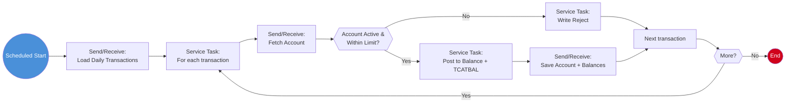

# Process: Transaction Posting (Batch Pipeline)

> **Powered by FLOWX.AI Coding Agents**

| Field | Value |
|-------|-------|
| **Name** | Transaction Posting |
| **Type** | Scheduled Process (orchestration) |
| **Legacy Source** | `CBTRN01C`/`CBTRN02C`/`CBTRN03C` via `POSTTRAN.jcl`, `COMBTRAN.jcl`, `DALYREJS.jcl` |
| **Status** | Draft |
| **Related Triggers** | [Scheduled Trigger — nightly posting](../05-triggers/trigger-inventory.md) |
| **Related Data** | [Transaction](../01-data-model/project-data-model.md#transaction), [Account](../01-data-model/project-data-model.md#account), [TransactionCategoryBalance](../01-data-model/project-data-model.md#transactioncategorybalance) |

## Business Description

Nightly pipeline that reads the day's incoming transactions, validates each against its account (status, credit limit), posts valid transactions to account balances and category balances (`TCATBALF`), and routes invalid ones to a rejects output. Replaces the `CBTRN*` batch posting chain driven by `POSTTRAN`/`COMBTRAN`, with rejects from `DALYREJS`.

## Process Flow

## Nodes

| # | Node | Type | Description | Legacy Reference |
|---|------|------|-------------|------------------|
| 1 | Scheduled Start | Start Event (Scheduled Trigger) | Nightly batch cycle | `POSTTRAN.jcl` submission |
| 2 | Load Daily Transactions | Send/Receive Message Task | Read daily input (GDG generation) | `CBTRN01C` read |
| 3 | For each transaction | Service Task (loop) | Iterate input | main read loop |
| 4 | Fetch Account | Send/Receive Message Task | Read owning account | `READ ACCTFILE` |
| 5 | Account Active & Within Limit? | Exclusive Gateway | Validation | credit-limit & status checks |
| 6 | Post to Balance + TCATBAL | Service Task (NoOpHandler) | Update balances | `CBTRN02C` posting |
| 7 | Save Account + Balances | Send/Receive Message Task | Persist | `REWRITE ACCTFILE`, `TCATBALF` |
| 8 | Write Reject | Service Task | Route invalid | `DALYREJS.jcl` |

## Business Rules

#### Rule: PostingValidation
- **Legacy source:** `CBTRN02C` posting validation.
- **Logic:** account must be active; transaction must not exceed available credit (`creditLimit - currentBalance`); card active.
- **FLOWX implementation:** NoOpHandler business rule per transaction in the loop.

#### Rule: UpdateCategoryBalance
- **Logic:** add transaction amount to the matching `TransactionCategoryBalance` (key = account + type + category).

## Data Mapping (collection loop)

- `inputKey`: `dailyTransactions` (source collection)
- `outputKey`: `postingResults` (posted + rejected)

## Integration Touchpoints

| Send Node | Topic | Payload | Receive | System |
|-----------|-------|---------|---------|--------|
| Load Daily Transactions | `ai.flowx.in.carddemo.datastore.loaddailytransactions` | `{ businessDate }` | Transaction[] | FlowX Persistence |
| Save Account + Balances | `ai.flowx.in.carddemo.datastore.postbatch` | `{ account, catBalances }` | ack | FlowX Persistence |

## Swimlanes

- **System** (unattended batch)

`{{TODO: Confirm GDG daily-cycle semantics — map to dated partitions/snapshots in FlowX Persistence. See CBTRN01-03C source for exact reject reasons.}}`

---
*Powered by **FLOWX.AI** Coding Agents*
