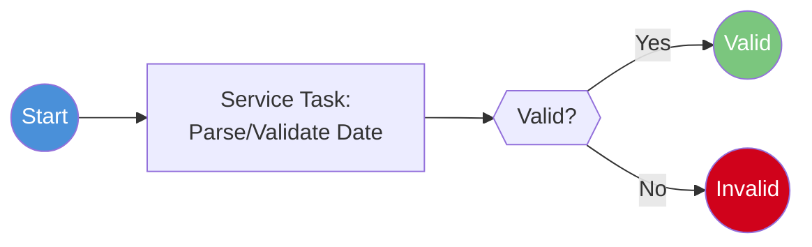

# Process: Date Utility (Call Activity)

> **Powered by FLOWX.AI Coding Agents**

| Field | Value |
|-------|-------|
| **Name** | Date Utility |
| **Type** | Call Activity (reusable subprocess) |
| **Legacy Source** | `CSUTLDTC` (+ Assembler `COBDATFT`) |
| **Status** | Draft |
| **Parent Processes** | [Transaction Add](process-transaction-add.md), [Reports](process-reports.md), batch pipelines |

## Business Description

Reusable date-format conversion/validation routine. Legacy CardDemo stores dates as `X(10)` strings and relies on `CSUTLDTC` / Assembler `COBDATFT` for conversion. In FLOWX most date handling is native; this call activity is retained only where legacy date semantics must be reproduced.

## Process Flow

## Nodes

| # | Node | Type | Description | Legacy Reference |
|---|------|------|-------------|------------------|
| 1 | Parse/Validate Date | Service Task (NoOpHandler) | Convert/validate date string | `CSUTLDTC`/`COBDATFT` |
| 2 | Valid? | Exclusive Gateway | Verdict | — |

## Data Mapping

**INPUT:** `{ dateString, format }` · **OUTPUT:** `{ isoDate, valid }`

`{{DECISION: In most cases replace with the platform date library inline (no call activity). Keep this call activity only if legacy date edge-cases (e.g., Gregorian/Lilian conversions in COBDATFT) must be preserved exactly.}}`

---
*Powered by **FLOWX.AI** Coding Agents*
