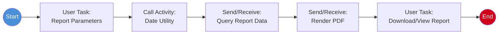

# Process: Reports

> **Powered by FLOWX.AI Coding Agents**

| Field | Value |
|-------|-------|
| **Name** | Reports |
| **Type** | Main Process |
| **Legacy Source** | `CORPT00C` / CR00 / BMS `CORPT00` (+ `TRANREPT.jcl`, `PRTCATBL.jcl`) |
| **Status** | Draft |
| **Related UI Flows** | [ui-flow-reports](../03-ui-flows/ui-flow-reports.md) |
| **Related Data** | [Transaction](../01-data-model/project-data-model.md#transaction), [TransactionCategoryBalance](../01-data-model/project-data-model.md#transactioncategorybalance) |

## Business Description

Captures report parameters (date range, account, category) and generates a transaction report, optionally rendered to PDF. Legacy `CORPT00C` collects parameters and the `TRANREPT`/`PRTCATBL` jobs produce printed reports.

## Process Flow

## Nodes

| # | Node | Type | Description | Legacy Reference |
|---|------|------|-------------|------------------|
| 1 | Report Parameters | User Task | Date range / filters | `RECEIVE MAP CORPT00` |
| 2 | Date Utility | Call Activity | Validate date range | `CSUTLDTC` |
| 3 | Query Report Data | Send/Receive Message Task | Aggregate transactions | `TRANREPT` logic |
| 4 | Render PDF | Send/Receive Message Task | Produce PDF | `TXT2PDF1.JCL` |
| 5 | Download/View | User Task | Deliver report | print/spool |

## Integration Touchpoints

| Send Node | Topic | Payload | Receive | System |
|-----------|-------|---------|---------|--------|
| Query Report Data | `ai.flowx.in.carddemo.datastore.queryreport` | `{ from, to, filters }` | aggregate rows | FlowX Persistence |
| Render PDF | `ai.flowx.in.carddemo.pdf.render` | `{ reportModel }` | PDF ref | [Statement PDF Renderer](../04-integrations/system-statementpdf.md) |

## Swimlanes

- **User, Admin**

## Subprocess Calls

- [Date Utility](process-date-utility.md)

---
*Powered by **FLOWX.AI** Coding Agents*
