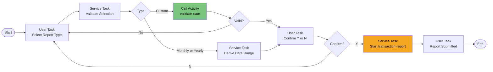

# Process: report-request

| Property | Value |
|----------|-------|
| Type | Main Process (also Call Activity from menu-navigation) |
| Legacy Source | `CORPT00C` (CR00), BMS `CORPT00`; submits the batch job `TRANREPT` through the CICS transient data queue to the internal reader |
| Trigger | Manual / Call Activity |
| Roles | Regular User, Administrator |
| UI Flow | [ui-flow-report-request](../03-ui-flows/ui-flow-report-request.md) |
| Starts | [transaction-report](process-transaction-report.md) (Start New Process) |
| Subprocess | [validate-date](process-validate-date.md) |
| Acceptance Criteria | [acceptance-criteria-report-request](../10-acceptance-criteria/acceptance-criteria-report-request.md) |
| Mapping | P-12 |

## Purpose

Lets a user request a transaction report for the current month, current year, or a custom date range. After confirmation the report job is started asynchronously.

## Process Flow

## Business Rules

| # | Rule | Legacy Source |
|---|------|---------------|
| BR-01 | One report type must be selected: "Select a report type to print report..." | `CORPT00C` |
| BR-02 | Monthly: start = first day of current month, end = last day of current month | `CORPT00C` |
| BR-03 | Yearly: start = 01 Jan, end = 31 Dec of current year | `CORPT00C` |
| BR-04 | Custom: start and end dates (month, day, year parts) all required: "Start Date - Month can NOT be empty..." etc.; numeric; valid calendar date via CSUTLDTC | `CORPT00C` |
| BR-05 | Confirmation required: "Please confirm to print the <type> report..." ; invalid: "Invalid value. Valid values are (Y/N)..." | `CORPT00C` |
| BR-06 | Report submission confirmation: "<type> report submitted for printing ..." | `CORPT00C` |
| BR-07 | The legacy JCL submitted from CICS carries the date range as symbolic parameters `PARM-START-DATE` / `PARM-END-DATE` (see `TRANREPT.prc`) | `CORPT00C`, `TRANREPT.prc` |

## Data Mapping

`StartNewProcessHandler` (or Call Activity) to [transaction-report](process-transaction-report.md): `startDate` ← `report.startDate`, `endDate` ← `report.endDate`, `requestedBy` ← `session.userId`, `reportType`.

{{DECISION: Use StartNewProcessHandler (fire-and-forget) so the user is not blocked while the batch report runs; result is delivered through the Document Plugin (see [document-strategy](../07-plugins/document-strategy.md)).}}

## Configuration Dependencies

Enumeration `ReportType`.
