# Process: transaction-report

| Property | Value |
|----------|-------|
| Type | Main Process (batch, on demand or scheduled) |
| Legacy Source | Job `TRANREPT` (`/app/jcl/TRANREPT.jcl`) and proc `/app/proc/TRANREPT.prc` (steps REPROC → SORT → `CBTRN03C`), copybooks `CVTRA05Y`, `CVTRA03Y`, `CVTRA04Y`, `CVTRA07Y` |
| Trigger | Started by [report-request](process-report-request.md) (user, date range) or by [end-of-day-batch-chain](process-end-of-day-batch-chain.md) (default range) |
| Roles | Batch Operator (system); requester receives output |
| Integration | [workflow-transaction-data-access](../04-integrations/workflow-transaction-data-access.md), [workflow-reference-data-access](../04-integrations/workflow-reference-data-access.md) |
| Plugin | [plugin-transaction-report-document](../07-plugins/plugin-transaction-report-document.md) |
| Acceptance Criteria | [acceptance-criteria-transaction-report](../10-acceptance-criteria/acceptance-criteria-transaction-report.md) |
| Mapping | P-18 |

## Purpose

Prints a detail report of transactions whose processing date falls in a range, sorted by card number, with page and card totals, descriptions of type and category (133 columns).

## Process Flow

```mermaid
flowchart LR
    S(["Start"]) --> SND1["Send Message<br/>Select Transactions in Range"]
    SND1 --> RCV1["Receive Message<br/>Transactions Sorted by Card"]
    RCV1 --> SP["Subprocess<br/>For Each Transaction"]
    SP --> SND2["Send Message<br/>Get Type and Category Names"]
    SND2 --> RCV2["Receive Message<br/>Names"]
    RCV2 --> L["Service Task<br/>Add Report Line and Totals"]
    L --> G{"More?"}
    G -->|"Yes"| SND2
    G -->|"No"| D["Service Task<br/>Request Document Generation"]
    D --> E(["End"])
    style SND1 fill:#F5A623,color:#000
    style RCV1 fill:#F5A623,color:#000
    style SND2 fill:#F5A623,color:#000
    style RCV2 fill:#F5A623,color:#000
    style SP fill:#4A90D9,color:#fff
```

## Business Rules

| # | Rule | Legacy Source |
|---|------|---------------|
| BR-01 | Filter on `processedTimestamp` between start and end date inclusive (SORT INCLUDE on proc date) | `TRANREPT.prc` |
| BR-02 | Sorted by card number | `TRANREPT.prc` |
| BR-03 | Each line shows type and category description via `TransactionType` / `TransactionCategory` lookup | `CBTRN03C` |
| BR-04 | Totals: page total, card total (on card change), grand total {{TODO: confirm totals layout in CVTRA07Y / CBTRN03C}} | `CBTRN03C` |
| BR-05 | Default date range comes from `PARM-START-DATE` / `PARM-END-DATE` SYMNAMES (2022-01-01 … 2022-07-06) → Configuration Parameters `reportStartDate`, `reportEndDate` | `TRANREPT.prc` |
| BR-06 | Report width 133 columns | `TRANREPT.jcl` |

## Data Mapping

Process start data: `startDate`, `endDate`, `requestedBy`, `reportType` (from [report-request](process-report-request.md)). Output: `reportDocumentRef`, `lineCount`, `grandTotal`.

## Configuration Dependencies

`reportStartDate`, `reportEndDate` (Configuration Parameters, per-run override); document template `transaction-report`.
